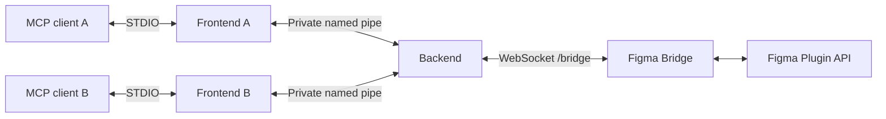

# Architecture

## Processes and transports

Each MCP client starts a frontend and exchanges MCP protocol messages over STDIO.
Frontends for the same OS user and Bridge port share one automatically started backend.

The frontend owns MCP session initialization, schemas, request IDs, cancellation and
result formatting. The backend owns the Bridge listener, in-memory plugin registry,
pending RPCs and serialization per connection. The same executable implements both roles.
See [ADR 0001](./decisions/0001-shared-companion) for the detailed decision.

## Startup and connection lifecycle

1. A frontend discovers or starts the backend using a private named pipe and user-scoped,
   cross-session startup/lifetime mutexes. The backend is detached from its launcher.
2. The backend binds exactly 127.0.0.1:3846 by default, or the explicit --port value.
   An occupied port produces an error; there is no automatic port fallback.
3. Frontend/backend IPC requires identical product versions and IPC protocol versions.
4. The plugin opens `ws://127.0.0.1:<port>/bridge` with figma-mcp-bridge.v2.
5. The backend validates hello, registers connection_id and returns hello_ack.
6. Every frontend sees the same list_figma_connections snapshot. Document tools require
   an explicit live connection_id and route through the shared backend.
7. On plugin disconnect, the registry removes the connection and fails pending RPCs.

A connection_id identifies a plugin invocation, not a persistent Figma file.
Replacement uses compare-and-swap so a stale socket cannot remove its replacement.

## Lifetime and recovery

The backend stops after 60 seconds without frontend sessions, plugin connections or
dispatched operations. Configure --idle-timeout-seconds or FIGMA_MCP_IDLE_TIMEOUT_SECONDS
(1..86400); CLI takes precedence. The first launcher sets the effective value for that
backend lifetime. Later clients receive that value without changing it.

Closing one frontend does not stop the backend. Its queued calls are canceled; already
dispatched calls retain their per-connection gate until response, disconnect or deadline.
Backend failure preserves frontend MCP sessions. Frontends reconnect or start a replacement;
pending calls fail and are never automatically replayed. The plugin reconnects to the same
port. Until then the registry is empty. A hung owner is reported unavailable, not killed.

A canceled or interrupted mutation may have executed in Figma. Inspect document state
before retrying. Neither rollback nor exactly-once execution is implied.

## Server diagnostics

get_server_info reports the backend's UUID, PID, product version, UTC startup time,
active plugin count and bound Bridge address, even without a plugin. All attached
frontends report the same identity. Its schema excludes environment, paths and credentials.
Readiness uses Kestrel's bound address after application startup.

Diagnostics go to frontend stderr through bounded IPC queues. MCP stdout contains only
protocol messages. No persistent discovery state or diagnostic files are required.

## Protocol and security boundaries

The Bridge remains one typed MessagePack map per binary WebSocket message with the
figma-mcp-bridge.v2 subprotocol, canonical UUIDs, UTC timestamps and bounded payloads.
Bridge messages are limited to 16 MiB; base64 binary data to 12 MiB. RPC has a 30-second
deadline after dispatch. Existing dry_run and invocation-local idempotency keys remain.

IPC uses length-prefixed typed MessagePack over current-user-only named pipes, with
independent request UUIDs per session and bounded admission. Windows elevated and
non-elevated clients cannot share a pipe. There is no HTTP management endpoint.

The Bridge remains loopback-only and validates Host, Origin and subprotocol. The plugin
stores only its local port and sends no access token. No plugin changes are part of
backend sharing. All connection and pending-request state remains in memory.

## Updating

Exact informational versions must match. To update, close clients and plugins, wait
for idle shutdown, then update and reopen. A running older version is never replaced
automatically. A legacy server without IPC occupying the port must also be stopped.
