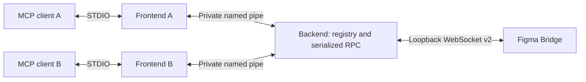

# ADR 0001: shared local companion

Status: accepted for issue #40.

## Context and decision

Each MCP client previously owned both its STDIO session and a Bridge listener. Plugin
connections were invisible to other chats. The executable now has two roles: a frontend
per client, and an automatically started backend shared by OS user and Bridge port.

Frontends own MCP initialization, tool schemas, request IDs and result rendering.
The backend owns Kestrel, plugin connections, pending Bridge requests and server identity.
The internal ICompanionBackend boundary provides asynchronous list, info and invoke calls.
No plugin code, settings, manifest or Bridge protocol changes are required.

## Discovery and ownership

The IPC name is derived from the OS user SID/UID and requested port. Neither product
version nor working directory is part of the name. Default startup and --port 3846
share a backend; different ports select independent groups. Ports are fixed: a bind
conflict is an error, never a reason to move a plugin to another port.

Two user-scoped, cross-session named mutexes coordinate startup and lifetime.
Acquisition and release happen on dedicated threads because mutex ownership is thread-affine.
A frontend first connects, then obtains the startup mutex and checks again before launching.
A live lifetime lock prevents replacement even if IPC is temporarily unavailable.
Only the backend owns the lifetime mutex, until its listeners have closed. OS cleanup
and abandoned-mutex handling remove the need for PID/discovery files.

The initial startup budget is 15 seconds. A random bootstrap pipe reports ready/error
to the initiating frontend. Readiness follows successful listener and IPC startup.

Windows uses local WMI COM process creation with hidden detached startup and job breakaway;
this avoids dependence on the first client's process tree. Unix uses a short-lived
shell launcher with positional arguments, redirected standard handles and setsid in
the backend. No service or autostart entry is installed. OS isolation policies are
not bypassed; a denied launch produces an error.

## IPC and security

System.IO.Pipes byte streams use CurrentUserOnly on both ends. Windows elevation
levels must match. IPC and mutex names are discovery identifiers, not authentication.
The Bridge retains its loopback bind, Host/Origin checks and v2 subprotocol.

IPC consists of a four-byte little-endian length followed by a typed MessagePack record.
The frame limit is 16 MiB + 64 KiB, checked before allocation; handshake limit is 16 KiB.
The existing untrusted-data MessagePack settings are reused, without typeless objects.
Invoke payloads remain binary; list/info metadata are typed JSON encoded in the binary
payload field. There is no additional base64 layer.

The handshake checks IPC version 1, exact product informational version (including build
metadata), and port. It returns backend UUID and effective idle timeout. Different
versions fail without stopping the owner or choosing another endpoint.

Each frontend has an independent duplex IPC session. Request UUIDs are separate from
MCP IDs and Bridge IDs. Messages cover request/response/error, cancel, heartbeat and
bounded diagnostics. The backend accepts at most 32 pending requests per session,
64 overall, and 64 MiB of retained input payloads. Excess work receives backend_busy
before dispatch. Existing 16 MiB Bridge and 12 MiB binary limits still apply.

## Lifetime and configuration

--idle-timeout-seconds overrides FIGMA_MCP_IDLE_TIMEOUT_SECONDS, default 60.
The selected value must be an integer in 1..86400; invalid selected values fail startup.
The first launcher sets backend policy; later clients receive the effective value and
a stderr diagnostic if their requested value differs. Recovery preserves that value.

Idle time starts only when there are no frontend sessions, plugin connections or
dispatched operations. New activity resets the countdown. An open plugin therefore
keeps the backend alive after all chats close. Activity registration and the transition
to stopping share a gate, preventing idle-shutdown races.

## Cancellation, failures and recovery

One backend serializes requests per live plugin connection; other connections can
progress independently. Queue cancellation prevents dispatch. Once dispatched, an
operation retains its gate until response, disconnect or its 30-second deadline,
even if the originating frontend cancels or exits. Responses are never reassigned to
a different session. Replacement sockets retain compare-and-swap removal semantics.

Frontends preserve MCP sessions while reconnecting. Heartbeats run every five seconds;
15 seconds without a response closes IPC. All pending calls fail on connection loss,
and no document call is replayed. Recovery discovers the existing owner or launches a
new one. Backoff grows from 250 ms to five seconds with jitter; persistent startup
errors wait 30 seconds. New calls during recovery fail promptly.

A hung owner is not killed automatically. If no frontend remains, the next MCP launch
performs recovery. The plugin's existing reconnect loop uses the same fixed port.

An interrupted mutation may already have executed. Cancellation is not rollback, and
this design does not promise exactly-once Figma execution after a crash or timeout.
Idempotency keys are forwarded unchanged, scoped to the plugin invocation rather than
the frontend. Users must reconcile uncertain results before retrying.

Errors distinguish backend_unavailable, backend_connection_lost,
backend_version_mismatch, backend_busy and backend_protocol_error. Document tools
retain their existing error structure; server-level tools return MCP tool errors.

## Diagnostics, updates and validation

get_server_info retains its schema and reports backend identity, PID, version, startup,
live plugin count and actual listener. Diagnostics travel through bounded IPC queues
to frontend stderr; no logs enter MCP stdout and no persistent log files are introduced.

To update, close old clients and plugins, wait for idle shutdown, update the package,
then reopen clients. A pre-IPC server occupying the port is a bind conflict. There is
no automatic takeover or administrative stop command in this change.

The removal of port fallback is a breaking behavior change. Existing root build and
release workflows remain the entry points. Process tests cover sharing, simultaneous
startup, first-client tree termination, backend crash recovery without replay, version
rejection, port conflicts, distinct ports and idle exit. Tests also cover IPC size and
cancellation boundaries. Published test artifacts include a real companion executable;
the existing CI test jobs cover Windows, Linux and macOS. Real Figma Desktop validation
remains necessary in addition to the synthetic Bridge scenarios.
